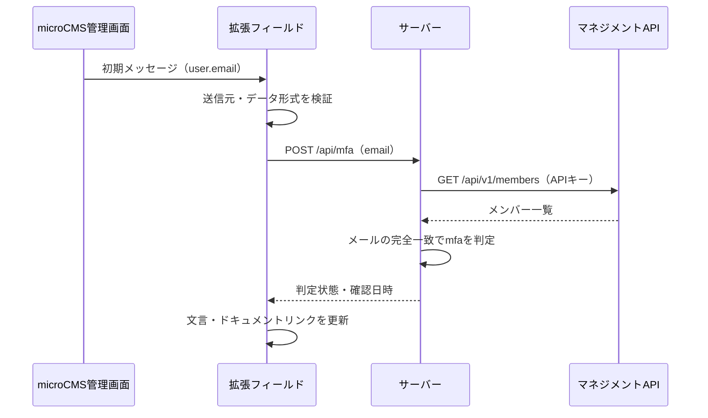

# microCMS 2要素認証チェック拡張フィールド

ログインユーザーのメールアドレスをmicroCMSのpostMessageから受け取り、サーバー側でメンバー一覧と照合して2要素認証の設定状況を表示します。SAMLは利用しない前提です。

画面・サーバー・テスト・開発スクリプトはTypeScriptで記述し、`strict: true`で型検査します。サーバーはNode.js 24の標準HTTP・fetch、拡張フィールド連携は公式の`microcms-field-extension-api`を使用しています。画面1つとAPI1つのためReact等のUIフレームワークやDBは使用しません。Node.js実行環境またはコンテナをホストできる環境へ配置できます。

`tsc`でサーバーとテストをコンパイルし、`esbuild`で画面と公式SDKを単一のJavaScriptにバンドルします。成果物は`dist/`に出力し、ブラウザ向けには`dist/public/`の必要なファイルだけを配信します。サーバー用のAPIキーをビルド時に読み込む処理はありません。

## 処理の流れ



サーバーに有効なキャッシュがある場合はマネジメントAPIへのアクセスを省略します。

## ディレクトリ構成

```text
src/
  client/
    app.ts               # 画面表示と照会APIへのリクエスト
    field-extension.ts   # 公式SDKによる受信、iframeの高さ更新
  shared/
    protocol.ts          # 初期メッセージ・メールの検証
    types.ts             # APIレスポンス型と実行時検証
  app.ts                 # HTTPルーティングと入力検証
  config.ts              # 環境変数の検証
  members.ts             # メンバー取得・照合・キャッシュ
  server.ts              # サーバー起動
public/                  # HTMLとCSS
scripts/                 # ビルド・開発・ブラウザ検証
test/                    # APIと判定処理の自動テスト
.github/workflows/       # GitHub Actions
```

## ローカル起動

```sh
npm ci
cp .env.example .env
# .envを編集
npm run build
npm start
```

| 環境変数 | 内容 |
| --- | --- |
| `MICROCMS_SERVICE_ID` | 対象サービスのID（ドメイン全体ではありません） |
| `MICROCMS_API_KEY` | 「メンバーの取得（一覧・詳細）」のみを許可したAPIキー |
| `APP_ORIGIN` | このアプリの公開オリジン。ローカル例：`http://localhost:3000`、本番例：`https://extension.example.com`。パスは指定しません |
| `PORT` | 待受ポート。既定値：3000 |
| `BIND_ADDRESS` | 既定値：`127.0.0.1`。コンテナ等では`0.0.0.0` |

APIキーはサーバーの環境変数またはホスティング基盤のシークレットとして設定します。`.env`をコミットしないでください。Dockerイメージにも含めません。`npm run dev`でソース変更を監視して再ビルド・再起動し、`npm run check`で型検査、`npm test`でビルドと自動テストを実行できます。

通常のブラウザでURLを直接開いた場合は、ログインユーザーを受信できないため約10秒後に確認不能の表示になります。

Google Chromeがある環境では`npm run test:browser`で実ブラウザの表示・再確認・iframe連携をローカルの模擬親画面で検証できます。実行ファイル名が異なる場合は`CHROME_BIN`を指定します。確認用画像は`artifacts/`に出力します。模擬画面はテスト専用プロセスにだけ存在し、本番サーバーでは配信しません。

## 開発コマンドとCI

| コマンド | 内容 |
| --- | --- |
| `npm run dev` | ソース変更を監視し、再ビルド・再起動 |
| `npm run check` | TypeScriptの型検査 |
| `npm run build` | 型検査・コンパイル・画面のバンドル |
| `npm start` | ビルド済みのサーバーを起動 |
| `npm test` | ビルド後に単体・HTTP結合テストを実行 |
| `npm run test:browser` | ビルド後にChromeでiframe連携・画面操作を検証 |

GitHub Actionsではpush／pull request時にNode.js 24で型検査、ビルド、自動テストを実行します。テストはモックAPIを使用するため、microCMSのAPIキーやGitHub Secretsの設定は不要です。Chromeを使う検証はローカルで別途実行します。

## microCMS側の設定

1. 専用APIキーを作成し、マネジメントAPIの「メンバーの取得（一覧・詳細）」だけを許可します。不要なコンテンツAPI権限は無効にします。
2. APIスキーマに「拡張フィールド」を追加し、URLに本アプリのルートURLを設定します。
3. このフィールドの必須設定はオフにします。
4. コンテンツの新規作成／編集画面で確認します。

本フィールドは表示専用です。`MICROCMS_POST_DATA`を送信せず、メールアドレスや設定状況をコンテンツに保存しません。ドキュメントは別タブで開きます。設定後は「再確認」を押してください。

### 公式SDKの利用箇所

- `src/client/field-extension.ts`で`setupFieldExtension`を使い、初期データ受信と初期サイズ設定を行います。
- SDK 1.1.0はoriginと`isTrusted`を確認しますが、親windowや受信データ形式の検証はアプリ側で補います。SDKが初期サイズを送信する前にcaptureリスナーで検証します。
- SDKのデフォルトコールバックは受信内容をログ出力するため、明示的に上書きしています。
- 動的な高さ変更には専用の送信関数がないため、SDKの`UpdateStyleMessage`型を使って送信します。
- コンテンツ保存用の`sendFieldExtensionMessage`は表示専用という要件に合わないため使用しません。

サーバーで行うメンバー一覧取得・照合は、拡張フィールドSDKの対象外なので引き続き標準fetchを使用します。

## デプロイ要件：IP許可リスト必須

**公開前に、デプロイ基盤／WAF／リバースプロキシで、会社または社内VPNの固定グローバルIP以外を拒否してください。アプリ自身はIP制限を実装していません。**

- 画面・静的ファイル・`POST /api/mfa`を含む全経路を保護します。microCMS管理画面側のIP制限だけではこのアプリは保護されません。
- VPN利用時は、このアプリへの通信もVPNの固定出口IPを経由させます。必要なIPv4／IPv6の出口アドレスを確認してください。
- HTTPSを終端し、`APP_ORIGIN`を実際の公開オリジンと一致させます。APIのOriginヘッダーはiframeアプリ自身のオリジンです。
- 基盤の標準URL、プレビューURL、別ドメイン、オリジンサーバーへの直接アクセスでIP制限を迂回できないようにします。WAFを使う場合、オリジン側でもWAFを通過した通信だけを受け付けます。
- アプリは`X-Forwarded-For`等をIP認証に使いません。実際の送信元IPは信頼できる基盤側で判定してください。
- `Content-Security-Policy: frame-ancestors https://{SERVICE_ID}.microcms.io`で対象サービスだけに埋め込みを許可します。基盤で`X-Frame-Options: DENY`／`SAMEORIGIN`を追加しないでください。
- 社内の許可IPから画面とAPIに到達できること、社外IPからは両方拒否されることを確認してから運用開始します。

IP制限は社内回線からのアクセスを確認するもので、個人認証ではありません。許可された回線内から任意のメールアドレスをAPIに送れば、その設定状況を照会できます。この信頼範囲を前提とした社内向けの案内表示です。ログインやコンテンツ公開を強制的に制限する機能ではありません。

任意の配置先で次のコンテナを利用できます（Dockerの利用は任意）。本番の環境変数は基盤側で注入してください。

```sh
docker build -t microcms-extension-2fa .
docker run --rm --env-file .env -e BIND_ADDRESS=0.0.0.0 -p 127.0.0.1:3000:3000 microcms-extension-2fa
```

`GET /healthz`はプロセスのヘルスチェックです。microCMSとの接続確認ではありません。必要なら基盤内部からのみ許可してください。

## 判定・障害時の動作

| 状態 | 表示 |
| --- | --- |
| 初期データ／API応答待ち | 確認中 |
| メールが一致し`mfa === true` | 2要素認証は設定済み |
| メールが一致し`mfa === false` | 2要素認証が未設定です。以下のドキュメントを参照して設定してください。＋設定手順へのリンク |
| メールなし／メンバーなし／不正レスポンス／通信失敗 | 設定状況を確認できませんでした。 |

- メッセージの送信元オリジン・親window・action・データ型を確認します。`isTrusted`だけを信用しません。
- APIは同一オリジンのJSON POSTだけを受け付けます。CORSを開放しません。これらは補助的な対策で、IP制限の代替ではありません。
- メールアドレスは完全一致で照合します。大文字小文字の変換やエイリアスの統合はしません。
- 一覧は`limit=100`と`token`で全ページを取得します。一部ページの取得に失敗した場合は全体を確認不能とします。重複メールや不正な`mfa`も確認不能です。
- 取得全体の期限は30秒、ブラウザ側は35秒です。繰り返すページトークンや100を超える継続トークンも打ち切ります。
- 全ページの結果はプロセス内だけに30秒キャッシュします。同時取得は共有し、通常のリクエストはキャッシュを利用します。「再確認」はキャッシュを更新しますが、連打対策として取得完了後5秒間は直前の結果を利用します。画面にも確認日時を表示します。
- マネジメントAPIのリクエスト開始間隔を1.1秒以上空けます。429／5xxは1回再試行し、429は最低10秒待ちます。取得失敗後は5秒間再取得を抑制し、古い成功結果を返しません。
- **キャッシュと間隔制御は1プロセス単位です。** 初期構成は1プロセス／1レプリカを想定します。複数レプリカや他のアプリと送信元IPを共有する場合は、IP単位のレート制限に合わせた共有キャッシュ／キューを別途用意してください。
- ブラウザには判定状態と確認日時のみを返します。APIキー、メンバー一覧、microCMSのエラー本文は返しません。HTTPレスポンスは`no-store`です。
- メールアドレスはURLに含めずPOST本文で送信します。基盤側のログでもリクエスト本文やAPIキーを収集しないようにしてください。

## 公開前の実環境確認

自動テストはモックのメンバーAPIで実行します。実サービスでは以下を確認してください。

1. `mfa: true`と`false`のそれぞれで文言が一致する。
2. ドキュメントが別タブで開き、設定変更後の再確認で表示が更新される。
3. 新規作成／編集、狭い画面でiframeの高さが適切で、コンテンツが変更済みにならない。
4. キーの権限不足や通信障害で「未設定」と誤表示しない。
5. ブラウザのNetworkにAPIキーやメンバー一覧が現れない。
6. 社外IP、標準URL、直接オリジンアクセスからの迂回を拒否できる。

## 公式仕様

- [拡張フィールド・postMessage](https://document.microcms.io/manual/field-extension)
- [メンバー一覧API](https://document.microcms.io/management-api/get-members)
- [マネジメントAPIの制限事項](https://document.microcms.io/manual/limitations)
- [2要素認証の設定](https://document.microcms.io/manual/mfa-setting)
